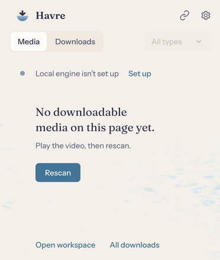
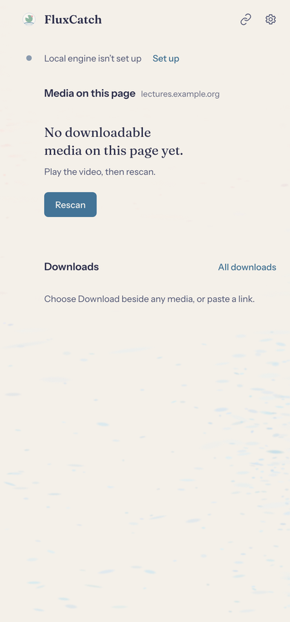
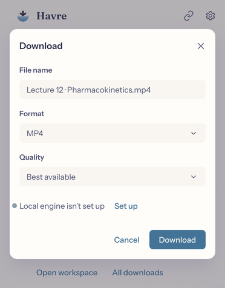
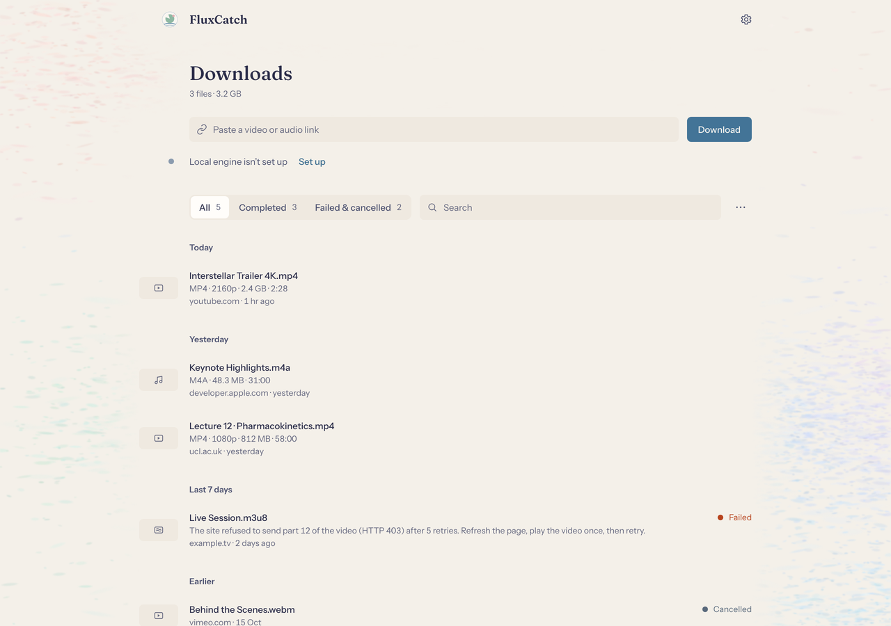
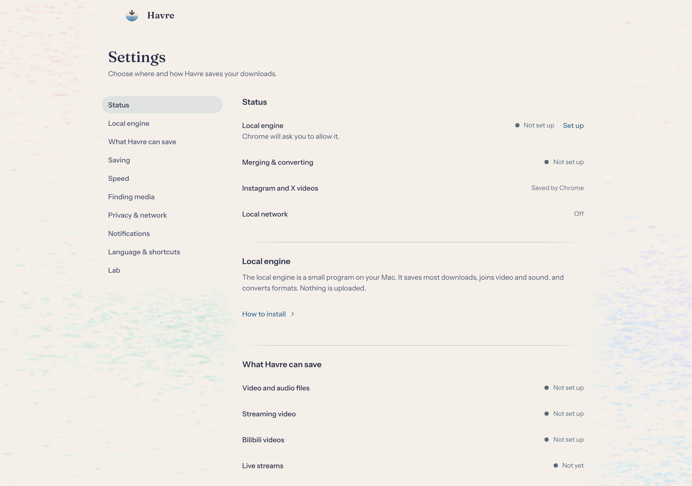
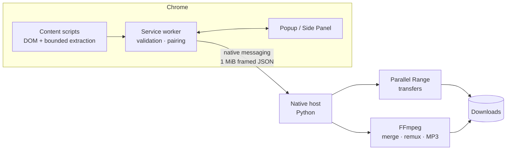

<div align="center">


# FluxCatch

**Keep what you see.**

*A local-first media downloader for Chrome on macOS*

FluxCatch is a Manifest V3 extension with a small local engine. It notices the
media a page is already playing (direct files, HLS, DASH), lists it with an
honest quality ladder, and saves it on your Mac through a policy-controlled
native host. No cloud, no relay, no account: the bytes travel between your
machine and the site you are looking at, nowhere else.

[](https://github.com/Blanchot-Alice/fluxcatch/releases)
[](https://developer.chrome.com/docs/extensions/develop/migrate)
[](LICENSE)
[](docs/INSTALL.md)
[](../../actions)

**English** · [简体中文](README.zh-CN.md)

</div>

---

## What you get

| | |
| --- | --- |
| 🔍 **Passive detection** | FluxCatch reads what the page itself requested. Optional quality enrichment is rate-limited, single-site, and one switch away from off. |
| 📺 **An honest quality ladder** | HLS variants and DASH representations are listed as they are, including the Bilibili ladder your signed-in account can actually play. |
| 🎚 **Grouped renditions** | Players that never expose a master playlist still get one card with a resolution menu; video and audio are merged losslessly with FFmpeg. |
| ⏯ **Pause, resume, queue** | Any job can be paused and picked up later: direct files resume from their checkpoint, HLS and DASH reuse every whole segment already on disk. |
| 📥 **Batch and link downloads** | "Download all" for the page, a link field for any media address, and a save folder you choose through the engine. |
| 🗂 **A real download history** | Files the engine saves never appear in `chrome://downloads`, so FluxCatch keeps its own day-by-day record with poster frames, search and Finder actions. |
| ⚡ **Conditional acceleration** | Parallel Range transfers when the server supports them, claimed only where they hold. |
| 🔒 **Local-first privacy** | No telemetry, no account, no relay. Cookies stay scoped to their origin and are stripped on cross-origin hops. |
| 🛡️ **DRM stays DRM** | Protected content is detected and reported, never decrypted and never bypassed. |

## Sites with first-class support

Generic detection covers most conventional players. These need more:

| Site | Status | Notes |
| --- | --- | --- |
| **Bilibili** `/video/` | 🧪 beta | DASH pairing, opaque quality selectors, login-aware ladder, signed URLs kept in memory only. Bangumi not claimed. |
| **Instagram** | 🧪 beta | Best complete MP4 from page/SPA payloads; playback fragments suppressed. |
| **X / Twitter** | 🧪 beta | Highest-bitrate progressive `video_info` MP4 preferred over HLS. |
| **YouTube** | 🧪 beta | The watch page is the row; the engine runs the Mac's own yt-dlp (`brew install yt-dlp`) behind a loopback broker that applies the pinned network policy. Quality ladder and title from yt-dlp, MP4/MKV/WebM/MP3 output. |
| **Pornhub** | 🧪 beta | The page's `flashvars` ladder (one signed HLS master per quality) becomes one card with a quality menu; the engine replays the page's Referer/Origin. |
| **MissAV** | 🧪 beta | The playlist address is decoded from the page's packed script without eval; the master's 360p–1080p ladder is read by the engine. |
| **Jable** | 🧪 beta | The page's `hlsUrl` AES-128 playlist; keys and segments go through the pinned client and FFmpeg decrypts locally. The site itself sits behind Cloudflare. |
| **The Economist Insider** | 🧪 beta | Subscriber episodes: the site's episode API and its session-gated Brightcove playlists are read with your own signed-in browser session; the engine downloads the renditions and merges the separate audio. Only what your subscription already plays. |

## The interface

Three surfaces and two pages share one design system, in **Morning** and
**Dusk** (following the system colour scheme) and in **English** or
**Chinese** (following Chrome, or set in Settings):

- the **popup** for the page you are on: detected media, the download queue, quick saves;
- the **side panel**, the workbench for long downloads;
- the **downloads page**, the complete record with search and Finder actions;
- **Settings**, which explains build identity, privacy boundaries, the save folder and what the engine can save in one reading flow;
- completion notifications that lead straight to the file.

| Popup | Side panel | Download dialog |
| :---: | :---: | :---: |
|  |  |  |

<p align="center"></p>

<p align="center"></p>

The ground is a still wash of colour, the **pond layer**: a few drifts of
celadon, lilac, rose and apricot, seeded once per install, visible only in
margins and empty space and masked under every piece of content. Progress bars
take the colour of their state. The header is the canvas itself at rest and
gains its tint only as the page scrolls. The fonts (Fraunces, Instrument Sans
and a Chinese display subset) ship with the extension; nothing is fetched from
the network. Keyboard operation, visible focus, narrow widths and
`prefers-reduced-motion` are supported throughout.

Every screen is held to a measured budget in Chrome for Testing
(`scripts/design-audit.mjs`): type styles, left edges, container nesting, text
contrast against the composited background, clipping, locale leaks, hairline
rules, the pond layer's chroma and lightness in the margins, and the header at
scroll position 0. The current build meets every budget on all 108 audited
screens, and `scripts/design-atlas.mjs` prints the captures of two runs side
by side. [DESIGN.md](DESIGN.md) is the short version of the rules.

## Quick start

**1 · Load the extension**

```bash
git clone https://github.com/Blanchot-Alice/fluxcatch.git
```

Open `chrome://extensions`, enable **Developer mode**, choose **Load unpacked**
and select `extension/`.

**2 · Install the local engine** *(macOS; most downloads need it)*

```bash
./scripts/native-install-wrapper.sh
```

It pins stable Homebrew paths, checks for Python 3.9 or newer and detects
FFmpeg. The ready-made [`v0.2.5` packages](https://github.com/Blanchot-Alice/fluxcatch/releases/tag/v0.2.5)
are the alternative: unzip the native bundle whole and run `./install-macos.sh`.
YouTube additionally needs the Mac's own yt-dlp (`brew install yt-dlp`);
Settings shows that row as "Needs an extra component" until it is there.

**3 · Use it**

Play something. The badge lights up. Click it. Download.

> Detection works without the engine. Most saves, merging, conversion and
> acceleration need it; saving through Chrome alone is limited to the narrowly
> allowlisted Instagram and X MP4 set.

<details>
<summary><strong>Development</strong></summary>

```bash
npm test                                  # extension unit + UI static tests
npm run test:coverage                     # unit coverage gate: 65% lines and branches, 55% functions (see below)
python3 -m unittest discover -s native-host/tests -v
python3 scripts/validate.py               # manifest + syntax validation
npm run test:e2e                          # Chrome detection, UI and interaction suite
npm run package                           # dist/ zips + SHA256SUMS
npm run verify:package                    # checksums, identity, safe ZIP metadata
node scripts/design-audit.mjs --label <name>            # the design audit, both themes and languages
node scripts/design-atlas.mjs --before <a> --after <b>  # before/after atlas PDF of two audit runs
node scripts/build-icons.mjs                            # rasterise the icons from their SVG sources
```

The coverage gate measures the modules the unit tests target; the service
worker (`extension/background.js`) and the Chrome tooling under `scripts/` are
exercised by the worker smoke test, the e2e suite and the design audit in
Chrome for Testing instead. CI builds release archives once, retains those
exact bytes, and runs Chrome E2E against that ZIP. Builds are byte-for-byte reproducible from
`SOURCE_DATE_EPOCH` or the commit time.

</details>

## How it fits together



Extension probes validate URL syntax, host category, purpose, provenance and
origin allowlists. Native transfers additionally pin connected peers, re-check
redirects and manifest children, and strip sensitive headers monotonically on
cross-origin transitions. Signed URLs live in service-worker memory for at most
two minutes; UI surfaces receive redacted metadata plus opaque references only.

Deep dives: [Architecture](docs/ARCHITECTURE.md) · [Design](DESIGN.md) ·
[Privacy](PRIVACY.md) · [Security](SECURITY.md) · [Release readiness](docs/RELEASE.md)

## License

[MIT](LICENSE). FluxCatch is for media you own or are permitted to save. It
does not decrypt DRM content or bypass access controls.
