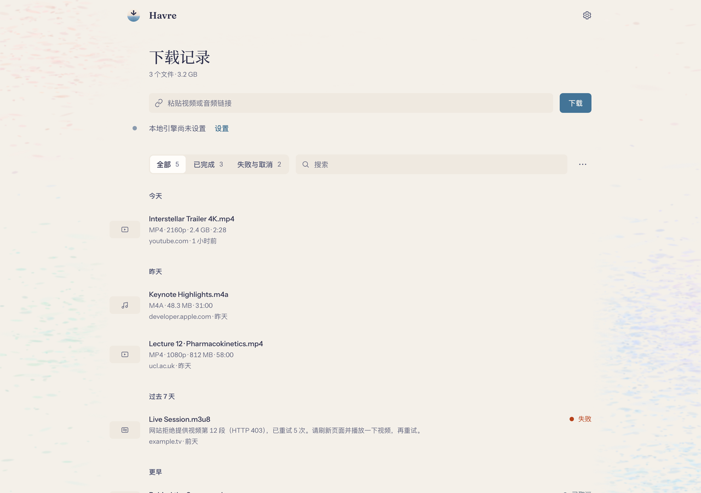
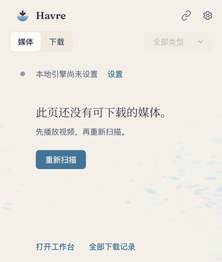
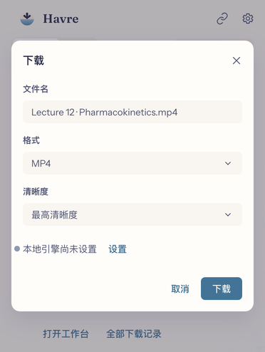

<div align="center">


# Havre

*所见，即所得。*

一个安静的 Chrome 媒体下载器，运行在 macOS 上。<br>
页面正在播放的内容，它替你存进自己的 Mac，不往别处送任何东西。

[English](README.md) · **简体中文**

</div>

<br>

<p align="center">
  
</p>

Havre（读作 *ahv-ruh*）是莫奈长大的港口勒阿弗尔，也是《印象·日出》画的地方，
印象派的名字正来自这幅画。作为普通名词，havre 是港湾：从水上来的东西在这里靠岸，
被好好收着。

## 它做什么

- **看见页面在放什么。** 直链文件、HLS、DASH，都从页面自己发出的请求里读。
- **列出真实存在的画质。** 同一个视频流的各档清晰度归在一张卡片里，用菜单挑选；在 B 站，列出的是你的账号实际能播的那几档。
- **由本地引擎保存。** 一个小小的 Python 引擎负责下载和暂停后的续传，服务器允许时分段并行传输，音视频用 FFmpeg 合并。
- **留一份记录。** 引擎存下的文件不会出现在 `chrome://downloads`，所以 Havre 自己记一份：按天分组，带封面帧、搜索和 Finder 操作。
- **只待在你的机器上。** 没有账号，没有遥测，没有中转。Cookie 只留在它所属的网站，每次跨域跳转都会去掉。
- **不碰 DRM。** 受保护的媒体只识别、只提示，从不解密。

## 有专门适配的网站

常见的播放器靠通用检测就够了。下面这些网站多花了些心思，适配都还在测试阶段。

| 网站 | Havre 读取什么 |
| --- | --- |
| Bilibili `/video/` | DASH 音视频配对，以及你的账号能播的画质阶梯。 |
| Instagram | 页面自带数据里最好的完整 MP4。 |
| X | 码率最高的渐进式 MP4。 |
| YouTube | 清晰度和文件都交给本机装好的 yt-dlp，连接受引擎网络策略的约束。 |
| Pornhub | 页面给出的清晰度阶梯，合成一张卡片。 |
| MissAV | 页面打包脚本里写着的播放列表，只解码，不执行。 |
| Jable | 页面的 AES-128 播放列表，由 FFmpeg 在本机解密。 |
| 经济学人 Insider | 你已登录的会话本来就能播放的订阅节目，连同单独的音轨。 |

## 安装

1. 克隆仓库，加载扩展。

   ```bash
   git clone https://github.com/Blanchot-Alice/havre.git
   ```

   打开 `chrome://extensions`，开启**开发者模式**，点**加载已解压的扩展程序**，
   选择 `extension` 文件夹。

2. 安装本地引擎。它需要 Python 3.9 或更新的版本，找到 FFmpeg 就会用上。

   ```bash
   ./scripts/native-install-wrapper.sh
   ```

   [Releases 页面](https://github.com/Blanchot-Alice/havre/releases)上也有现成的包：
   把引擎压缩包整个解开，运行 `./install-macos.sh`。从 FluxCatch 0.2.5 升级时，
   你选过的保存目录会原样保留。

3. 想下载 YouTube，再装一个 yt-dlp：`brew install yt-dlp`。Havre 不自带它。

之后打开一个正在播放的页面。工具栏图标上出现数字时，点开它，挑出你想留下的。

没有引擎也能检测。多数保存、合并和转换都要靠引擎；只用 Chrome 能存下的，
仅限 Instagram 与 X 的完整 MP4。

## 界面

弹出窗口对着眼前这一页，侧边栏照看耗时长的下载，下载记录页存着全部记录，
设置页从上往下读一遍就明白。外观跟随系统的浅色或深色，分别叫清晨与黄昏；
语言跟随 Chrome，英文或中文，也可以在设置里指定。全程能用键盘操作，也尊重
“减少动态效果”。字体随扩展一起打包，绘制界面时不从网络取任何东西。

<p align="center">
  
  &nbsp;&nbsp;&nbsp;
  
</p>

外观背后的规则写在 [DESIGN.md](DESIGN.md) 里，`scripts/design-audit.mjs` 会对照它
检查每一屏。

## 开发

```bash
npm test                     # 扩展的单元测试与界面测试
npm run test:coverage        # 同上，附覆盖率门槛
python3 -m unittest discover -s native-host/tests
python3 scripts/validate.py  # manifest 与语法检查
npm run test:e2e             # 在 Chrome for Testing 里检验检测、界面与交互
npm run package              # 在 dist/ 生成发布包和 SHA256SUMS
```

延伸阅读：[架构](docs/ARCHITECTURE.md)、[安装](docs/INSTALL.md)、
[隐私](PRIVACY.md)、[安全](SECURITY.md)。

## 许可

[MIT](LICENSE)。Havre 用来保存你拥有或有权保存的媒体，不解密 DRM，也不绕过访问控制。
