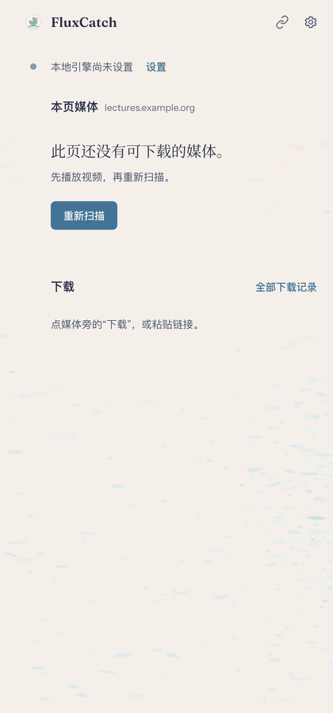
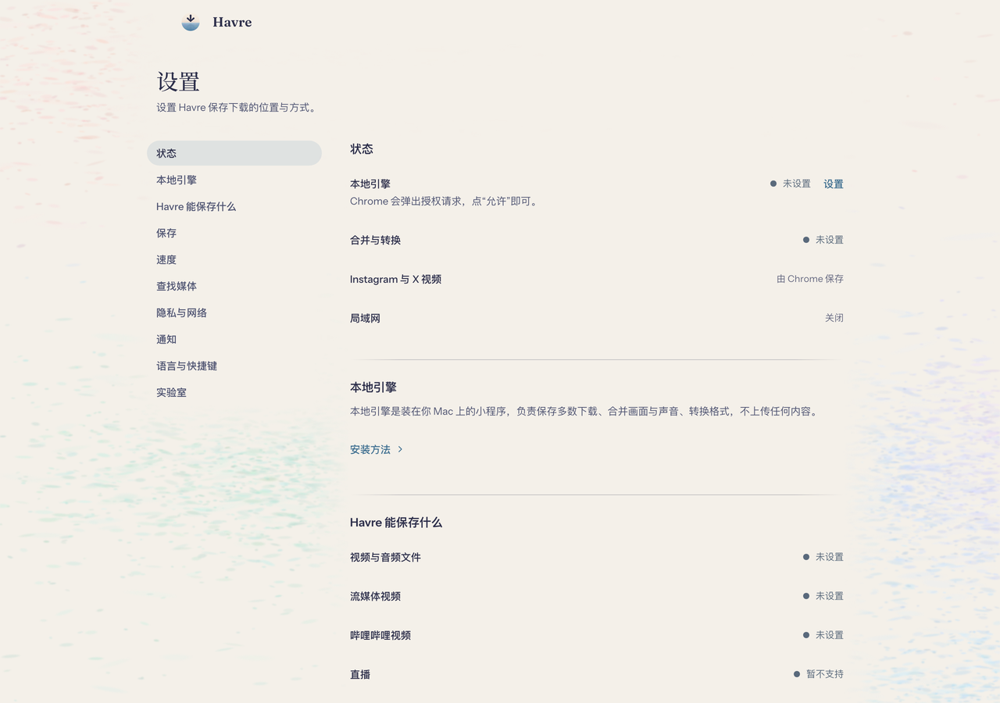
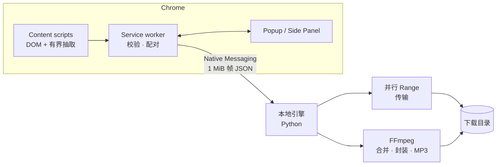

<div align="center">


# Havre

**所见，即所得。**

*本地优先的媒体下载器 · macOS 上的 Chrome*

Havre 是勒阿弗尔，莫奈长大的港口，也是《印象·日出》所画的地方，印象派因这幅画得名。
普通名词 havre 的意思是港湾、避风港：东西从水上进来，在这里被稳妥地留住。

Havre 是一个 Manifest V3 扩展，配一个很小的本地引擎。页面在放什么，它就
看见什么：直链文件、HLS、DASH，列成一张如实的画质阶梯，再经由受策略约束的本地
引擎保存到你的 Mac 上。没有云端，没有中转，没有账号；字节只在你的机器和你正在
看的网站之间往来。

[](https://github.com/Blanchot-Alice/fluxcatch/releases)
[](https://developer.chrome.com/docs/extensions/develop/migrate)
[](LICENSE)
[](docs/INSTALL.md)
[](../../actions)

[English](README.md) · **简体中文**

</div>

---

## 你会得到什么

| | |
| --- | --- |
| 🔍 **被动检测** | 只读页面自己请求过的内容。可选的画质补全有速率限制、只针对单一站点，一个开关就能关掉。 |
| 📺 **如实的画质阶梯** | HLS 变体和 DASH 分辨率照原样列出，包括你登录账号在 B 站真正能播的那一档。 |
| 🎚 **变体合并** | 播放器从不给出主列表，也能合成一张带清晰度菜单的卡片；音视频由 FFmpeg 无损合并。 |
| ⏯ **暂停、续传、排队** | 任何任务都能暂停、稍后接着下：直链从断点续传，HLS 与 DASH 复用磁盘上已有的每个完整分片。 |
| 📥 **整页下载与链接下载** | 一键下载整页媒体，链接框可以粘贴任何媒体地址，保存目录经由引擎自己选。 |
| 🗂 **真正的下载记录** | 引擎保存的文件不会出现在 `chrome://downloads`，所以 Havre 自己记一份按日分组的记录，带封面帧、搜索和 Finder 操作。 |
| ⚡ **看条件加速** | 服务器支持 Range 才并行传输；只在成立的地方才这么说。 |
| 🔒 **本地优先的隐私** | 没有遥测、账号和中转。Cookie 只限原站，跨域跳转时去掉。 |
| 🛡️ **DRM 就是 DRM** | 受保护的内容只检测、只提示，从不解密，也不绕过。 |

## 专门适配的站点

通用检测覆盖多数常规播放器，这些站点需要多做一些：

| 站点 | 状态 | 说明 |
| --- | --- | --- |
| **Bilibili** `/video/` | 🧪 内测 | DASH 音视频配对、不透明清晰度选择器、登录感知的画质阶梯、签名链接仅存内存。番剧页不在支持声明内。 |
| **Instagram** | 🧪 内测 | 从页面/SPA 数据中选出最佳完整 MP4；播放分片自动抑制。 |
| **X / Twitter** | 🧪 内测 | 优先最高码率的 `video_info` 渐进式 MP4，而非 HLS。 |
| **YouTube** | 🧪 内测 | 观看页本身就是候选行；引擎调用本机已装的 yt-dlp（`brew install yt-dlp`），所有连接经本机回环代理套用同一套网络策略。清晰度梯度与标题来自 yt-dlp，可输出 MP4/MKV/WebM/MP3。 |
| **Pornhub** | 🧪 内测 | 页面 `flashvars` 里的清晰度梯度（每档一个签名 HLS 主列表）合成一张带清晰度菜单的卡片；引擎回放页面的 Referer/Origin。 |
| **MissAV** | 🧪 内测 | 从页面的 packer 脚本里解出播放列表地址，不执行页面代码；主列表的 360p 到 1080p 梯度由引擎读取。 |
| **Jable** | 🧪 内测 | 页面 `hlsUrl` 指向的 AES-128 播放列表；密钥与分片走固定客户端，FFmpeg 本地解密。站点本身在 Cloudflare 之后。 |
| **经济学人 Insider** | 🧪 内测 | 订阅者节目：站点的节目 API 与需要登录会话的 Brightcove 播放列表由您自己已登录的浏览器会话读取，引擎下载各档画质并合并独立音轨。只下载您的订阅本来就能播放的内容。 |

## 界面

三个界面和两个页面共用一套设计系统，有**清晨**和**黄昏**两套主题（跟随系统
外观），界面语言为**英文**或**中文**（跟随 Chrome，也可在设置里指定）：

- **弹出窗口**，针对当前页面：检出的媒体、下载队列、快速保存；
- **侧边栏**，长时间下载的工作台；
- **下载记录页**，完整的记录，带搜索和 Finder 操作；
- **设置页**，把构建身份、隐私边界、保存目录和引擎能保存什么放在同一段阅读流里；
- 完成通知直接通向文件。

| 弹出窗口 | 侧边栏 | 下载对话框 |
| :---: | :---: | :---: |
|  |  |  |

<p align="center"></p>

<p align="center"></p>

背景是一层静止的色彩，叫作**池塘图层**：几条青瓷、丁香、玫瑰和杏色的漂带，每台
机器安装时定一次，只在留白和空白处显露，所有内容下方都被遮掉。进度条用它所处
状态的颜色。页眉静止时就是画布本身，页面滚动后才染上颜色。字体（Fraunces、
Instrument Sans 和一份中文标题字子集）随扩展一起打包，不从网络取任何东西。键盘
操作、可见焦点、窄窗口和 `prefers-reduced-motion` 全程支持。

每一屏都在 Chrome for Testing 里按量化预算检查（`scripts/design-audit.mjs`）：
字体样式数、左侧对齐线、容器嵌套、对合成背景的文字对比度、裁切、语言泄漏、细线、
留白里池塘图层的色度与明度，以及滚动位置 0 时的页眉。当前构建的 108 个审计屏全部
满足预算；`scripts/design-atlas.mjs` 把两次运行的截图并排打印成图集。规则的简版
在 [DESIGN.md](DESIGN.md)。

## 快速开始

**一 · 加载扩展**

```bash
git clone https://github.com/Blanchot-Alice/fluxcatch.git
```

打开 `chrome://extensions`，开启**开发者模式**，点**加载已解压的扩展程序**，
选择 `extension/` 目录。

**二 · 安装本地引擎** *（macOS，多数下载需要它）*

```bash
./scripts/native-install-wrapper.sh
```

脚本会固定 Homebrew 的稳定路径，检查 Python 3.9 或更新的版本，并探测 FFmpeg。
也可以用 [Releases 页面](https://github.com/Blanchot-Alice/fluxcatch/releases)上的现成包：
native 压缩包整体解压后，在它的目录里执行 `./install-macos.sh`。安装脚本会把 0.2.5 的安装接过来：
保留你选过的保存目录，换掉旧的引擎注册，删除旧的运行副本。YouTube 另外需要
本机的 yt-dlp（`brew install yt-dlp`），装好之前设置页里那一行显示“需要额外组件”。

**三 · 使用**

打开正在播放的页面，角标亮起，点一下，下载。

> 不装引擎也能检测和预览。多数保存、合并、转码和加速需要引擎；只靠 Chrome
> 保存的，仅限白名单里 Instagram 与 X 的完整 MP4。

<details>
<summary><strong>开发</strong></summary>

```bash
npm test                                  # 扩展单测 + UI 静态测试
npm run test:coverage                     # 单元覆盖率门槛：行与分支 ≥65%，函数 ≥55%（见下）
python3 -m unittest discover -s native-host/tests -v
python3 scripts/validate.py               # manifest 与语法校验
npm run test:e2e                          # Chrome 检测 / UI / 交互套件
npm run package                           # dist/ 双包 + SHA256SUMS
npm run verify:package                    # 校验和、构建身份、ZIP 安全元数据
node scripts/design-audit.mjs --label <名称>            # 设计审计，两套主题、两种语言
node scripts/design-atlas.mjs --before <a> --after <b>  # 两次审计的前后对照图集 PDF
node scripts/build-icons.mjs                            # 从 SVG 源文件栅格化图标
```

覆盖率门槛只量单元测试针对的模块；service worker（`extension/background.js`）
和 `scripts/` 下的 Chrome 工具由 worker 冒烟测试、e2e 套件和设计审计在 Chrome for
Testing 里检验。CI 只构建一次发布归档并原样保留这些字节，E2E 跑在这份 ZIP 上。从
`SOURCE_DATE_EPOCH` 或提交时间出发，同样的树得到逐字节一致的产物。

</details>

## 架构总览



扩展侧探针校验 URL 语法、主机类别、用途、来源与 origin 白名单；本地引擎进一步
钉住对端、复核重定向与清单子资源，并在跨域跳转时单调去掉敏感头。签名链接至多
在 service worker 内存里存活两分钟；界面只会收到脱敏元数据和不透明引用。

深入阅读：[架构文档](docs/ARCHITECTURE.md) · [设计说明](DESIGN.md) ·
[隐私政策](PRIVACY.md) · [安全策略](SECURITY.md) · [发布就绪](docs/RELEASE.md)

## 许可证

[MIT](LICENSE)。Havre 用于保存你拥有或获准保存的媒体；它不解密 DRM
内容，也不绕过访问控制。
