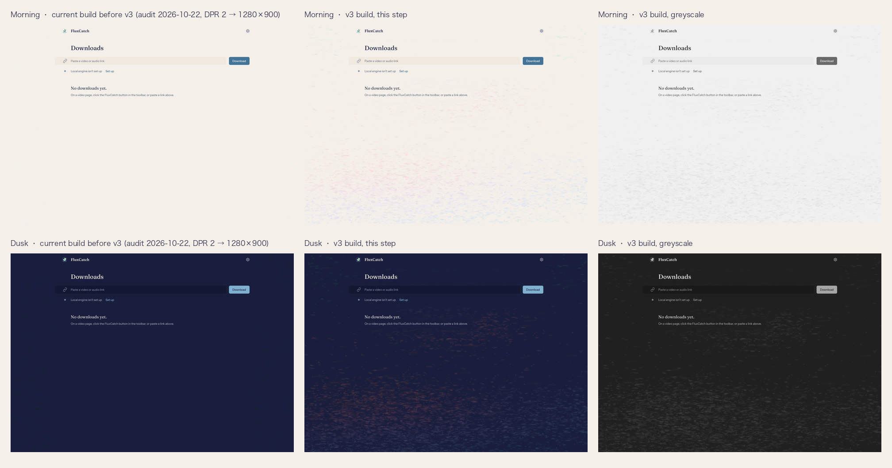

# Step v3-1: the pond layer on the Downloads empty state, waiting for approval
# 第 v3-1 步：池塘层已铺在下载记录页的空状态上，等待批准

Design review v3 §5 says: port `pond_layer.py` to Canvas 2D, show it on the Downloads empty state in Morning and Dusk at 1280 × 900 with a greyscale pair and the §3.1 metrics, then stop. This page is that stop. Step 2 of §5 (every surface, the progress colours, the grid, the lead frames) has not started.
设计评审 v3 第 5 节的要求是：把 `pond_layer.py` 移植到 Canvas 2D，只在下载记录页的空状态上显示，截取晨与暮两套主题在 1280 × 900 下的画面及其灰度版，附上第 3.1 节的指标，然后停下。本页就是这个停顿点。第 5 节的第 2 步（铺到所有界面、进度色、网格、行首框）没有开始。

Nothing outside the Downloads empty state has changed. The popup, the side panel and Settings still draw the v2 layer; the Downloads page shows no pond on its history and live-download states until step 2 decides their masks.
下载记录页的空状态之外没有任何改动。弹窗、侧边栏和设置页仍画 v2 的池塘层；下载记录页在有记录和下载中两种状态下暂不显示池塘，等第 2 步定下它们的遮罩。

## What to review · 请审阅

All files are in `docs/design-review/pond-reference/`, next to the script's own renders.
所有文件都在 `docs/design-review/pond-reference/`，与脚本自己渲染的参考图放在一起。

- **The two screens:** `build-empty-morning.png`, `build-empty-dusk.png` (1280 × 900, DPR 1, English, the script's seed `0xF1C4C7` stored as the install seed).
  **两张画面**：`build-empty-morning.png`、`build-empty-dusk.png`（1280 × 900，DPR 1，英文界面，把脚本的 seed `0xF1C4C7` 存为本机 seed）。
- **Their greyscale versions:** `build-empty-morning-grey.png`, `build-empty-dusk-grey.png`.
  **灰度版**：`build-empty-morning-grey.png`、`build-empty-dusk-grey.png`。
- **Side by side with the current build:** `build-contact-sheet.png` (left: the v2 layer from the audit run of 2026-10-22, brought from DPR 2 to 1280 × 900, also saved as `build-v2-empty-*.png`; middle: this step; right: its greyscale).
  **与现有版本并排**：`build-contact-sheet.png`（左：2026-10-22 审计运行里的 v2 图层，从 DPR 2 缩到 1280 × 900，另存为 `build-v2-empty-*.png`；中：本步；右：本步的灰度版）。
- **The numbers:** `build-metrics.txt` (readable) and `build-metrics.json`; `build-capture.json` records the canvas token, the column edges and the content boxes the mask used.
  **数字**：`build-metrics.txt`（可读版）和 `build-metrics.json`；`build-capture.json` 记录了画布令牌、内容列边缘和遮罩用到的内容框。
- **The targets to compare against:** `pond-mock-empty-morning.png`, `pond-mock-empty-dusk.png` (the review's mocks) and `metrics.txt` (the script's own numbers).
  **对照目标**：`pond-mock-empty-morning.png`、`pond-mock-empty-dusk.png`（评审的示意图）和 `metrics.txt`（脚本自己的数字）。

## The §3.1 metrics · 第 3.1 节的指标

Measured on the captures in OKLCH against the canvas token, as `pond_layer.py` measures its own renders. "Margins" are the Downloads page's two gutters at 1280 (x < 200 and x ≥ 1080, 360 000 px), where nothing but the layer is drawn. The full-page row includes the masked content column, so it is lower than the script's unmasked number by construction.
按 `pond_layer.py` 度量自身渲染结果的方法，在截图上以 OKLCH 对画布令牌测得。“页边区”指下载记录页 1280 宽时的左右两条留白（x < 200 与 x ≥ 1080，共 360 000 像素），那里只有池塘层。“整页”一行包含被遮罩的内容列，所以天然低于脚本不加遮罩的数字。

| Metric · 指标 | Target · 目标 | Morning · 晨 | Dusk · 暮 | Script, same seed · 脚本，同一 seed |
|---|---|---|---|---|
| Margins: chroma coverage (ΔC > 0.015) · 页边区彩度覆盖率 | 4 % to 12 % | **3.4 %** (below · 低于下限) | **3.9 %** (below · 低于下限) | 4.3 % / 4.1 % |
| Margins: p95 \|ΔL\| · 页边区 p95 \|ΔL\| | ≤ 0.03 / ≤ 0.05 | 0.017 ✓ | 0.039 ✓ | 0.020 / 0.041 |
| Margins: mean \|ΔL\| · 页边区平均 \|ΔL\| | n/a | 0.002 | 0.005 | n/a |
| Full page, content masked: coverage · 整页（遮罩后）覆盖率 | n/a | 4.9 % | 5.9 % | 6.4 % / 7.8 % (no mask · 无遮罩) |
| Full page, content masked: p95 \|ΔL\| · 整页（遮罩后）p95 \|ΔL\| | n/a | 0.021 | 0.047 | 0.025 / 0.048 |
| Rows 420 to 900, all x (no mask there): coverage · 420 到 900 行全宽（无遮罩）覆盖率 | n/a | 7.4 % | 8.1 % | 9.9 % / 9.2 % (reference PNG · 参考图) |
| v2 build, margins: coverage · v2 版本页边区覆盖率 | n/a | 0.4 % | 1.0 % | 0.3 % (metrics.txt, full page · 整页) |

Both p95 \|ΔL\| targets are met. Margin coverage misses the 4 % floor by 0.6 (Morning) and 0.1 (Dusk) points. Two things explain it, and neither is a parameter I changed:
两个 p95 \|ΔL\| 目标都达到了。页边区覆盖率差 4% 下限 0.6 个百分点（晨）和 0.1 个百分点（暮）。原因有两个，都不涉及我改参数：

1. **The band depends on the seed.** With the script itself, unmasked, at 1280 × 900, margin coverage over six seeds runs from 2.8 % to 6.8 % in Morning and from 1.6 % to 7.6 % in Dusk (listed at the end of `build-metrics.txt`); four of the twelve seed-theme pairs sit below 4 %, the review's own seed among the lowest. The drifts land where the seed puts them, and the gutters are 16 % of the page.
   **这条区间随 seed 变化。** 用脚本本身、不加遮罩、1280 × 900，六个 seed 下页边区覆盖率晨色在 2.8% 到 6.8% 之间，暮色在 1.6% 到 7.6% 之间（列在 `build-metrics.txt` 末尾）；十二个 seed 与主题的组合里有四个低于 4%，评审自己用的 seed 恰好偏低。漂带落在 seed 指定的位置，而两条留白只占页面的 16%。
2. **The port renders a little paler in Morning.** Where no mask applies (rows 420 to 900), the build reaches 7.4 % against the reference image's 9.9 % in Morning and 8.1 % against 9.2 % in Dusk; in the Dusk gutters below that line the two are identical (6.0 %). The Morning gap comes from the gamut clamp the review asked me to keep: the lightest touches (L about 0.92 to 0.93 at the rose and apricot hues) exceed sRGB at the specified chroma, and pond.js lowers their chroma until they fit, where the script clips the RGB channels instead, which keeps more chroma difference. Canvas 2D also quantises alpha to 8 bits and draws the soft ellipse as a nine-stop radial gradient of the script's feather curve.
   **移植版在晨色下略淡一点。** 在没有遮罩的区域（420 到 900 行），本版晨色 7.4% 对参考图 9.9%，暮色 8.1% 对 9.2%；暮色下这条线以下的页边区两者完全一致（6.0%）。晨色的差距来自评审要求保留的色域压缩：最亮的那批笔触（L 约 0.92 到 0.93，玫瑰与杏色相）在指定彩度下超出 sRGB，pond.js 把彩度压到放得下为止，而脚本是直接截断 RGB 通道，后者留下的彩度差更多。另外 Canvas 2D 的透明度是 8 位，软椭圆用脚本羽化曲线的九段径向渐变画出。

Nothing in the layer was tuned by prose (§6). If the band is to hold on every install, step 4 has to decide what it measures: pin the audit's seed (the audit already seeds storage before each run), or measure coverage on the unmasked full page, where the script lands between 3 % and 12 % over the same six seeds.
图层没有按文字描述做任何调参（第 6 节）。如果这条区间要在每台机器上都成立，第 4 步得先定度量方式：给审计固定 seed（审计本来就在每次运行前写入存储），或者改在不加遮罩的整页上量覆盖率，脚本在同样六个 seed 下的整页覆盖率落在 3% 到 12% 之间。

## What was ported, and how · 移植了什么，怎么移植的

- `extension/ui/v2/pond.js`: `planPond()` follows `render_pond(spec="v3")` draw for draw with the same mulberry32 sequence: 6 drifts per 1280 × 900 (scaled by √area, never fewer than 3), each a Gaussian 12 to 38 % of the width by 4 to 13 % of the height with its hue position; the 2-octave 1 × 9 value noise made the way Pillow makes it (random lattice quantised to 8 bits, bicubic a = −0.5 in two passes, 8-bit between them, normalised to 0 to 1); density `(0.012 + 0.988·d^2.2)·(0.6 + 0.4·band)`; 420 / 2 600 / 3 800 touches per 1280 × 900 placed by rejection sampling with the same size, angle, lightness-offset, chroma and alpha ranges; the family hues (celadon, pond-soft, lilac, rose, apricot, in that order) interpolated along the drift's hue position with N(0°, 9°) jitter, never across red. `renderPondBitmap()` stamps each touch as a feathered ellipse (full inside d ≤ 0.55, `((1 − d)/0.45)^0.75` to the rim); `applyContentMask()` is `column_mask` for any number of boxes (distance to the box, 64 px linear feather, the smallest factor winning); `PondLayer` caches one plan and one ImageBitmap per theme and 128 px viewport bucket; `mountPondLayer()` draws the cached bitmap into a `<canvas>` under the page, masks it, and repaints on resize (300 ms debounce), theme change and `refresh()`. The 0.7 px blur is a CSS filter on the layer element, after the mask, in the script's order (mask, composite, blur).
  `extension/ui/v2/pond.js`：`planPond()` 逐次抽样地照搬 `render_pond(spec="v3")`，mulberry32 序列完全相同：每 1280 × 900 六条漂带（按 √面积缩放，不少于三条），每条是宽 12% 到 38%、高 4% 到 13% 的高斯分布并带自己的色相位置；1 × 9 格、两个倍频的值噪声按 Pillow 的做法生成（随机格点量化到 8 位，a = −0.5 的双三次插值分两遍做，中间也是 8 位，再归一到 0 到 1）；密度 `(0.012 + 0.988·d^2.2)·(0.6 + 0.4·band)`；每 1280 × 900 共 420 / 2 600 / 3 800 个笔触按密度场拒绝采样，尺寸、角度、明度偏移、彩度、透明度区间不变；色相族（青瓷、池蓝、淡紫、玫瑰、杏，依此顺序）沿漂带的色相位置插值，加 N(0°, 9°) 抖动，永不跨过红色。`renderPondBitmap()` 把每个笔触画成羽化椭圆（d ≤ 0.55 内实心，到边缘按 `((1 − d)/0.45)^0.75` 衰减）；`applyContentMask()` 就是 `column_mask`，支持任意多个框（到框的距离、64 px 线性羽化，重叠处取较小值）；`PondLayer` 按主题和 128 px 视口桶各缓存一份规划和一张 ImageBitmap；`mountPondLayer()` 把缓存位图画进页面之下的 `<canvas>`、套遮罩，在窗口缩放（300 ms 去抖）、主题切换和 `refresh()` 时重画。0.7 px 模糊是图层元素上的 CSS filter，在遮罩之后，顺序与脚本一致（遮罩、合成、模糊）。
- `extension/downloads/downloads.js` mounts it with the page's content boxes (the header, the title and its summary, the link row, each status line that has text, the filter row, the live and history lists, and each text block of the empty state, read from the live layout) and shows it only while the empty state is shown.
  `extension/downloads/downloads.js` 用页面的内容框挂载它（页眉、标题及摘要、链接行、每条有文字的状态行、筛选行、下载中与历史两个列表、空状态的每个文字块，全部从当前布局读取），并且只在空状态显示时显示图层。
- `extension/ui/v2/tokens.css` gains `--pond-families` (the five family hues, numbers, so no colour literal outside the token files); `system.css` gives `.pond[data-layer="v3"]` no CSS mask and the blur. The theme comes from the root's `color-scheme`, the canvas lightness from `--canvas`.
  `extension/ui/v2/tokens.css` 新增 `--pond-families`（五个色相族的度数，是数字，不构成令牌文件之外的颜色字面量）；`system.css` 给 `.pond[data-layer="v3"]` 去掉 CSS 遮罩并加上模糊。主题读根元素的 `color-scheme`，画布明度读 `--canvas`。
- Tests: `tests/ui-v2.test.js` checks the plan against the script's numbers (6 drifts, the three counts and ranges, the mean lightness offsets per scale in both themes, the same positions for both themes from one seed, three drifts for the popup, touches gathering into drifts), the mask geometry, and the colour helpers; the v2 planner keeps a determinism check. 376 tests pass.
  测试：`tests/ui-v2.test.js` 按脚本的数字检查规划（六条漂带、三种尺度的数量与区间、两套主题下各尺度的平均明度偏移、同一 seed 两套主题位置相同、弹窗三条漂带、笔触聚成漂带）、遮罩几何和颜色工具；v2 规划器保留一条确定性检查。376 项测试通过。

## Settings terms that were "Proposed" and are now live (§3.8) · 改名表中“待批准”而现已上线的设置页词条（第 3.8 节）

From `rename-table.md`, rows whose status was Proposed (or "Proposed elsewhere") and whose term now ships in Settings (`extension/ui/v2/messages/settings.js`):
以下取自 `rename-table.md` 中状态为“待批准”（或“其余待批准”）且现已出现在设置页（`extension/ui/v2/messages/settings.js`）的条目：

1. Status / 状态 (was Runtime · Runtime identity & capabilities · 运行身份与能力概览).
2. Local engine / 本地引擎 (the one name for the native host; the table applied it on Downloads only).
3. Set up / 设置 and Not set up / 未设置 (the engine permission; applied on Downloads only before).
4. Finishing setup… / 正在完成设置… (in place of "connection bridge · 连接接口").
5. Merging & converting / 合并与转换 (was FFmpeg local processing).
6. Instagram and X videos / Instagram 与 X 视频, with Saved by Chrome / 由 Chrome 保存 (was the Chrome direct lane · 例外通道 · 可信直链).
7. Local network · Off / On · 局域网 · 关闭 / 开启 (was Network scope · Public networks only).
8. The capability rows with Yes / Not yet · 支持 / 暂不支持 values: Video and audio files, Streaming video, Bilibili videos, Live streams, Encrypted streams, Videos with separate sound, YouTube, Video thumbnails, and Copy-protected video (the last from the "Not yet supported" row; the "Encrypted HLS shows Available" contradiction of step 4 is gone, the row now reads the engine's state).
9. No section numbers · 去掉 01 到 08 的编号.
10. Connections per streaming video / Connections per large file (was HLS segment concurrency · Range 并发数).
11. Ignore files smaller than (KB) / 忽略小于此大小的文件 (was Minimum media size (KiB); decimal, as the table warned).
12. File-name chips Title · Site · Type · Resolution · Date · 标题 · 站点 · 类型 · 分辨率 · 日期 (were the raw `{title} {host} …` tokens).
13. Find more qualities on Bilibili / 在哔哩哔哩上查找更多清晰度, one line: Uses your Bilibili sign-in on that page. Nothing is uploaded.
14. Allow downloads from my home network / 允许从家庭网络下载, one line: Router and system addresses stay blocked.
15. Sign-in info / 登录信息 · Used only for the site it came from · Never stored (the table's one sentence became a line and a value).
16. Language / 语言 · Auto / 自动.
17. Lab, Developer tools / 实验室，开发者工具, off by default, with Version info / 版本信息 and compatibility shown as OK / Update needed / Not connected (was View build & capability details · Extension ID · Protocol & capability profile).
18. The page subtitle Choose where and how FluxCatch saves your downloads. / 设置 FluxCatch 保存下载的位置与方式。 (was "Tune the download experience…").
19. Removed, as proposed: "Local-first media instrument", "First confirm that the extension, the local helper and the capability profile all agree.", and the "UI editor" header entry (the editor now sits inside Lab, under Developer tools).

Not in the table, so never marked Proposed: the section names What FluxCatch can save / FluxCatch 能保存什么, Saving / 保存, Speed / 速度 with the Speed preset / 速度预设 (Steady · Balanced · Fast / 稳定 · 平衡 · 高速), Finding media / 查找媒体, Privacy & network / 隐私与网络, Notifications / 通知, Language & shortcuts / 语言与快捷键 and Lab / 实验室. They came with the §6.13 Settings rebuild in step 5 and have not been through the table. Any of the 19 above (or these) that you reject gets a one-line alternative before step 2 touches Settings copy.
不在改名表里、因此从未标过“待批准”的有这些分区名：FluxCatch 能保存什么、保存、速度及其速度预设（稳定 · 平衡 · 高速）、查找媒体、隐私与网络、通知、语言与快捷键、实验室。它们随第 5 步按第 6.13 节重做设置页时一起出现，没有走过改名表。上面 19 条（或这些分区名）里你否掉的任何一条，我会在第 2 步动设置页文案之前先给出一行替代方案。

## Decisions for you · 需要你拍板

1. **Accept the layer as ported,** with margin coverage 3.4 % / 3.9 % against the 4 % floor, and settle in step 4 how the band is measured (pinned seed, or the unmasked full page).
   **是否接受现在这个移植结果**：页边区覆盖率 3.4% / 3.9%，低于 4% 的下限；度量方式（固定 seed，或改量不加遮罩的整页）留到第 4 步定。
2. **The gamut clamp.** Keeping it (as instructed) is what makes Morning paler than the script. Switching to the script's RGB clip is a two-line change in `oklchToRgb`; I have not made it.
   **色域压缩**：按要求保留它，正是它让晨色比脚本淡一点。改成脚本的 RGB 截断只需在 `oklchToRgb` 里改两行；我没有改。
3. **The Settings terms above.**
   **上面的设置页词条。**
4. **The Downloads page between states:** with history or a live download it now shows no pond at all. Step 2 can give those states the layer with the row and list boxes masked; until then the page is plain.
   **下载记录页的其它状态**：有记录或有下载在进行时，现在完全不显示池塘。第 2 步可以给这些状态铺上图层并遮住行与列表；在那之前页面是素的。

## Interpretations and deviations · 解读与偏离

- "Show the layer on the Downloads empty state only" is read as: the v3 layer appears there and nowhere else, and the other surfaces keep exactly what they had. So `pond.js` carries both generators for now: `PondLayer` / `mountPondLayer` (v3) and `mountPond` / `planTouchesV2` (the old `planTouches`, renamed, still used by the popup, the side panel, Settings and the preview). Step 2 deletes the v2 path.
  “只在下载记录页的空状态显示”理解为：v3 图层只出现在那里，其它界面保持原样。所以 `pond.js` 暂时同时带着两个生成器：`PondLayer` / `mountPondLayer`（v3）和 `mountPond` / `planTouchesV2`（原来的 `planTouches`，改了名，弹窗、侧边栏、设置页和预览页仍在用）。第 2 步删除 v2 路径。
- The viewport bucket is 128 px, so a 1280 × 900 window plans the layer at 1280 × 1024 and shows its top 900 rows; counts scale with the planned area, so density is unchanged, but the drifts are not the reference image's drifts even with the reference seed. The two captures are therefore the port's own composition, compared with the script by its numbers, not pixel for pixel.
  视口桶是 128 px，所以 1280 × 900 的窗口按 1280 × 1024 规划图层、只显示上面 900 行；笔触数量按规划面积缩放，密度不变，但漂带的位置与参考图不同，即使 seed 相同。因此这两张截图是移植版自己的构图，与脚本的比较靠数字而非逐像素。
- The Dusk canvas token is `#1A1E3D` (OKLCH L 0.249); the script's `HEX["dusk_canvas"]` is `#1C2140` (L 0.260). The build reads the token, which is the 0.25 the review states. The script's Dusk references were rendered on the slightly lighter value.
  暮色画布令牌是 `#1A1E3D`（OKLCH L 0.249）；脚本的 `HEX["dusk_canvas"]` 是 `#1C2140`（L 0.260）。本版读令牌，也就是评审写的 0.25；脚本的暮色参考图是在稍亮的那个值上渲染的。
- The mask takes each content box separately (the review: "every content box… each text block"), so the empty sentence and its body line each clear their own 64 px, as the review's text says; the script's mock cleared one box for the header block and left the sentence on the open pond.
  遮罩按内容框逐个处理（评审原文：“每个内容框……每个文字块”），所以空状态的那句话和它下面的一行各自清出 64 px，与评审正文一致；脚本的示意图只给页眉那一块清了一个框，让那句话直接落在池塘上。
- The seed stays the per-install integer in `chrome.storage.local`; the captures store the script's seed first so the composition can be compared with the reference's numbers. The layer is static, so reduced motion needs nothing.
  seed 仍是存在 `chrome.storage.local` 里的本机整数；截图前先写入脚本的 seed，以便与参考数字比较。图层是静止的，减少动态效果无需处理。
- Cost: planning the 1280 × 1024 layer takes about 65 ms in Node on this Mac; the draw and the mask were not timed in Chrome. Plan and bitmap are cached, so a resize within the same bucket only re-masks.
  开销：在这台 Mac 的 Node 里规划 1280 × 1024 的图层约 65 ms；Chrome 里的绘制和遮罩没有计时。规划和位图都有缓存，同一个桶内的缩放只重新套遮罩。

## Found along the way, not fixed · 过程中发现、尚未修复

- **The design audit's pond rule is the v2 rule** ("visible as colour, gone in greyscale": footprint ≥ 0.5 %, p95 ΔL* ≤ 1.5). Run on the Downloads surface after this step (`tools/live/out/design-audit/v3-step1/`), every other budget passes on all 24 screens, and the pond column fails by design: the empty states carry value now (p95 ΔL* about 4.0, which §4 erratum 1 withdraws as a criterion), and the history and live-download screens at 1280 show no pond where the old rule expects one. §5 step 4 replaces this check with the §3.1 acceptance and the composited-background contrast.
  **设计审计里的池塘规则还是 v2 的规则**（“彩色可见、灰度消失”：占比 ≥ 0.5%，p95 ΔL* ≤ 1.5）。本步之后只对下载记录页跑了一次审计（`tools/live/out/design-audit/v3-step1/`），24 张画面的其它预算全部通过，池塘一列按设计不通过：空状态现在带明度差（p95 ΔL* 约 4.0，第 4 节勘误 1 已撤回这条标准），而 1280 宽的有记录与下载中画面在旧规则期待池塘的地方没有池塘。第 5 节第 4 步会用第 3.1 节的验收标准和合成背景对比度替换这条检查。
- The audit's `pond.present` still looks for a `background-image` on the pond element; the v3 layer is a canvas, so that flag reads "present, no image" and the audit falls back to hiding the element. It works, but step 4 should read the canvas.
  审计里的 `pond.present` 仍去找池塘元素的 `background-image`；v3 图层是 canvas，这个标志会读成“存在但无图”，审计于是退回到隐藏整个元素的办法。能用，但第 4 步应改为读 canvas。
- `tests/ui-v2-preview.test.js` still asserts the v2 opening (`--open-x` / `--open-y`) on the preview page; it goes with the v2 path in step 2.
  `tests/ui-v2-preview.test.js` 仍断言预览页上 v2 的开口（`--open-x` / `--open-y`）；它随 v2 路径在第 2 步一起处理。
